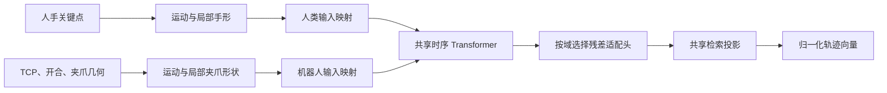

# 轨迹实验重新设计建议

初稿日期：2026-10-08。本文保留调研与候选设计，不作为当前实验注册表。
2026-10-10 同步：已实现的矩阵为 T0–T5、N1–N3，以增强＋双 Transformer 的 T3 为基线，
N1 为初始掌部归一化、N2 为运动/手形分离、N3 为二者组合；当前训练预算 65 epoch。
夹爪原始反馈和几何缓存已补齐至 dataset。实际输入、结构与入口见
[轨迹模板](S43.md)，数据来源见 [数据存储说明](../RH20T_SPLIT_AND_MANIFESTS.md)。
下文共享 Transformer 等其它结构仍属于候选建议，不代表已经验证优于当前设置。

## 1. 论文主线与推荐完整候选

建议将论文主线定为：

**通过统一的抓取几何表示，减少人手与不同夹爪之间的形态差异，再用时序模型学习动作相似性，实现人类—机器人轨迹检索。**

实验依次回答三个问题：

1. 几何对应是否有效？
2. 时序模型和适配头是否必要？
3. 归一化是否改善泛化与鲁棒性？

最优设置由验证集选出，测试集用于检验这些结论。

推荐完整候选：

**抓取中心运动＋局部手形双分支、人类/机器人分别做输入映射、共享小型时序 Transformer、双域残差适配头、共享检索投影、跨域＋模态内对比损失。**

## 2. 当前数据与模型的实际条件

当前模型是两套独立的轨迹 Transformer，最后共用一个投影头；人手输入关键点，机器人输入 TCP 位姿。
轨迹编码器从头训练，没有视频模态那样的预训练骨干。
见[当前模型实现](../../src/bise/modalities/trajectory/models/trajectory_encoder.py)。

RH20T 的 cfg2 是 **Flexiv＋AG-95**，cfg3 是 **UR5＋WSG-50**，机械臂与夹爪同时变化。
因此 cfg2→cfg3 适合验证跨配置泛化，但不足以单独证明对夹爪差异的适应能力。
cfg4 是 **UR5＋Robotiq 2F-85**，将来可以用 cfg3/cfg4 补充机械臂相同、夹爪不同的比较，
同时控制任务和环境差异。
见[官方机器人配置](https://raw.githubusercontent.com/rh20t/rh20t_api/main/configs/configs.json)。

调研初稿时子集未找到夹爪开合或关节状态文件；此后已补齐原始 `gripper.npy` 和派生 `geometry.npy`。
人手相机轨迹的有效帧覆盖率中位数，cfg2/cfg3 约为 **31.7%/36.9%**。
因此，补齐夹爪状态、正确处理缺测，应优先于扩大模型。
上述数据统计来自调研时的历史 s42 批次的
[cfg2 清单](../../artifacts/manifests/retrain/s42/cfg2/data_manifest.json)和
[cfg3 清单](../../artifacts/manifests/retrain/s42/cfg3/data_manifest.json)，后续数据更新时需要重新核对。

## 3. 相关工作及参考价值

| 工作 | 核心内容 | 对当前轨迹实验的参考价值 |
|---|---|---|
| [DexPilot，ICRA 2020](https://arxiv.org/abs/1910.03135) | 从裸手视觉观测控制机器人手臂与灵巧手 | 人机对应可以通过抓取几何和重定向建立 |
| [DexMV，ECCV 2022](https://yzqin.github.io/dexmv/) | 提取人手与物体三维运动，将人类示范转换为机器人示范 | 有条件时加入物体相对运动，减少操作位置变化的影响 |
| [AnyTeleop，RSS 2023](https://yzqin.github.io/anyteleop/) | 支持不同机械臂、机械手；分别处理腕部运动和手指姿态 | 支持“整体运动＋局部手形”分解 |
| [UMI，RSS 2024](https://umi-gripper.github.io/) | 通过手持夹爪收集示范，使用相对轨迹接口实现跨机器人部署 | 优先统一末端运动、方向和开合，而不是机器人关节角 |
| [CrossDex，ICLR 2025](https://arxiv.org/abs/2410.02479) | 用指尖和掌部位置统一不同灵巧手的观测空间 | 直接支持用机械手关键点减少形态差异 |
| [Analyzing Key Objectives in Human-to-Robot Retargeting，2026](https://mingrui-yu.github.io/retargeting/) | 比较全局位姿、指尖关系、指尖方向等目标的作用 | 关键点的功能和方向信息，比单纯增加数量更值得研究 |
| [TCC，CVPR 2019](https://arxiv.org/abs/1904.07846)、[Soft-DTW，ICML 2017](https://proceedings.mlr.press/v70/cuturi17a.html) | 对齐不同速度、不同长度的动作执行 | 为人机示范的软时序对齐提供依据 |
| [UMR，2026 预印本](https://arxiv.org/abs/2609.34256) | 分解任务相关物体运动与末端运动，建立统一几何表示 | 可作为后续加入物体轨迹的参考；目前尚属预印本 |

这些工作主要研究重定向、模仿学习或控制。
可以借鉴它们的几何表示和对齐方法，检索损失与评估协议仍需围绕当前任务设计。

## 4. 机械手关键点与人机几何对应

### 4.1 从机器人原始数据计算关键点

机械手关键点可以提取，但需要 TCP 之外的开合状态和夹爪几何。
对于目前的两指夹爪，优先采用运动学计算。

设 TCP 位置、旋转为 $p_t,R_t$，夹爪开合状态为 $w_t$，则关键点可以写成：

$$
k_{j,t}=p_t+R_t\,f_j(w_t;\mathcal G)
$$

其中 $\mathcal G$ 包含夹爪尺寸、指尖几何、TCP 到夹爪参考系的标定；
$f_j$ 描述该夹爪在开合状态下的关键点位置。
复杂连杆夹爪需要对应的运动学模型，多指灵巧手则需要各指关节状态。

RH20T 官方提供夹爪宽度与 `gripper.npy`，因此这条路线具有数据基础。
需要先从原始数据恢复当前子集缺少的字段，优先使用实际反馈状态，
并检查单位、时间同步和 TCP 定义。
见[RH20T 数据说明](https://rh20t.github.io/)。

### 4.2 优先统一功能量

| 功能量 | 人手侧 | 机器人侧 |
|---|---|---|
| 操作中心 | 捏取时可用拇指与参与抓取指尖的中点；其他抓法另行定义 | 两指接触区域中心 |
| 开合 | 拇指与抓取指尖的距离 | 实际夹爪宽度 |
| 闭合方向 | 对应指尖之间的方向 | 两夹指的闭合轴 |
| 接近方向/姿态 | 掌部坐标系、必要时加入指尖方向 | 标定后的夹爪接近轴和姿态 |

先对捏取类任务验证这个对应，再扩展到包握等抓法。
人手参与抓取的手指不同，固定“拇指—食指”对应不能覆盖全部任务。

机器人可以使用操作中心、两个指尖等少量关键点，并附带方向或姿态。
**中心与两个指尖通常共线，单靠它们不能表示完整朝向。**
方向虚拟点可以帮助编码，但它们只是位姿的另一种表示，没有增加独立观测信息。

### 4.3 必须区分新增信息与表示方式的贡献

一个非常关键的消融是：

> TCP 位姿＋开合标量，与由相同信息计算出的机械手关键点，哪种表示更好？

它能区分提升来自新增开合信息，还是来自关键点表示的几何归纳偏置。
不建议给两指夹爪人为补出 21 个点，制造与人手相同的拓扑。

## 5. 人手归一化与运动/手形分离

目前 N1/N2 使用的是**初始参考系**，不是逐帧把手移回原点；它们仍然保留整体移动。
见[当前归一化实现](../../src/bise/data/rh20t/human_representation.py)。

| 表示 | 定义 | 实验目的 |
|---|---|---|
| N0 | 基坐标系中的原始人手 XYZ | 保留全局位置，测量是否依赖场景位置 |
| N1 | 全序列减去第一有效帧的腕部位置 | 单独验证平移归一化 |
| N2 | 全序列变换到第一有效帧的掌部坐标系 | 验证平移与旋转归一化 |
| 新候选 | 整体运动使用初始参考系；局部手形使用当前掌部参考系 | 分离搬运运动与手指姿态 |

新候选包含两个分支：

- **运动分支**：操作中心的相对位置、方向，以及时间信息；可消融速度特征。
- **手形分支**：当前掌部坐标系内的指尖/骨向量、开合及其变化。

手形分支可按稳定的手部骨长归一化，机器人开合可按夹爪能力范围归一化。
**整体运动保留米制尺度**，避免把整个动作包围盒缩成统一大小，丢失动作距离。

现有 N0–N2 没有做人手尺寸归一化。
因此“尺寸归一化”应作为单独消融，不能归到 N2 的贡献中。
初始掌部姿态也需要质量检查，避免稀疏轨迹的第一帧异常影响整条轨迹。

## 6. 关键点数量

建议做 3、6、21 三组，11 点作为扩展。

| 人手输入 | 组成 | 回答的问题 |
|---|---|---|
| 3 点 | 腕部＋拇指尖＋食指尖 | 捏取任务能否用最少信息完成检索？ |
| 6 点 | 腕部＋五个指尖 | 是否已经覆盖大部分有效手形信息？ |
| 21 点 | 全部关键点 | 中间关节是否带来额外收益？ |
| 11 点，选做 | 腕部＋五指末端关节＋五个指尖 | 指尖方向能否补足 6 点表示？ |

先以 **6 点作为完整模型的候选输入**，最终由验证集决定。

所有组应共用同一份 21 点提取结果、scene、相机和观测掩码，再选择传给模型的点。
否则少点组可能因为有效帧更多而获益，无法解释为关键点数量的效果。
掌部姿态等辅助量也要保持一致；此时消融测量的是“模型输入点数”，
不是提取器仅依赖这些点的能力。

## 7. 模型架构与适配头

### 7.1 推荐完整候选

建议初始候选使用 **128 维、3 层 Transformer、128 维检索向量**。
保留当前双编码器作为强基线，并用 TCN 做一个结构更简单的对照。
不同关键点数量通过逐点 MLP 与聚合映射到固定维度，尽量控制参数量变化。

### 7.2 适配头的受控比较

| 设置 | 结构 | 作用 |
|---|---|---|
| 共享投影 | 两域共用最终 MLP | 最简单的共同嵌入空间 |
| 独立双投影 | 人类、机器人各一个 MLP | 允许分别修正域差异 |
| **双残差适配＋共享投影** | 两域各有小型残差模块，最后共用投影 | 保持共享表示，同时吸收观测噪声和运动学差异 |

推荐优先验证第三种，但三组必须在**同一个骨干、同一种输入表示**上比较。
当前共享投影头的结果不能直接证明共享骨干更好，因为当前骨干实际是两套独立网络。

### 7.3 冻结骨干实验的前提

“冻结＋机器人单头、冻结＋双头、微调＋双头”可以作为后续实验，
前提是先用训练集完成有效的轨迹自监督预训练，并共用同一个预训练检查点。
当前阶段优先端到端训练小模型。

## 8. 主比较实验

主比较推荐保留下面七组，其中四组需要训练。
新设计可用 `R` 编号，与现有 T1–T5/N0–N2 区分。

所有训练组使用相同数据、训练预算、正样本规则及损失权重；
主比较检验整套方案，消融定位各部件贡献。

| 编号 | 设置 | 论文中回答的问题 |
|---|---|---|
| B0 | 随机排序 | 指标的随机水平是多少？ |
| B1 | 共同几何描述的重采样欧氏距离 | 简单几何匹配能达到什么水平？ |
| B2 | 相同共同几何描述的 DTW | 允许速度变化后，传统方法是否足够？ |
| R0 | 现有结构：21 点 N0＋相对 TCP，双 Transformer、共享投影 | 当前方法的受控基线 |
| R1 | 统一抓取几何＋运动/手形分离，保留双 Transformer、共享投影 | 统一表示是否有效？ |
| R2 | R1 的表示＋共享 Transformer＋双残差适配＋共享投影 | 推荐完整候选 |
| R3 | R2 的时序 Transformer 换成 TCN | Transformer 是否确有必要？ |

B1/B2 必须比较共同描述，例如操作中心运动、方向和开合，
不能直接计算“人手 63 维与机器人 9 维”的距离。
几何权重在验证集确定，缺测位置不能当作真实零坐标计算距离。

## 9. 消融实验

按单因素组织，避免把所有因素做笛卡尔积。

| 因素 | 对比设置 | 优先级 |
|---|---|---|
| 机器人几何 | 原 TCP → 标定后的抓取中心位姿 → 加开合 → 相同信息的关键点表示 | **必做** |
| 人手归一化 | N0/N1/N2；运动与局部手形分离；局部尺寸归一化另测 | **必做** |
| 关键点数量 | 3/6/21；11 点可后补 | **必做** |
| 编码器共享 | 双时序编码器 vs 共享时序编码器，其他模块固定 | **必做** |
| 适配头 | 共享投影、独立双投影、双残差适配＋共享投影 | **必做** |
| 对比损失 | 仅跨域 vs 跨域＋模态内 | **必做** |
| 时间信息 | 基础时间信息 vs 加实际时间间隔、速度/开合变化 | 建议 |
| 缺测处理 | 当前处理 vs 短缺口插值且保留观测标志；长缺口保持缺测 | **高优先级** |
| 时序对齐 | 无对齐 vs Soft-DTW 或 TCC 风格的软对齐 | 选做 |
| 池化 | CLS vs 按观测掩码池化 | 选做 |

### 9.1 正样本定义与检索粒度

跨域正样本应明确区分“配对 scene”和“同 task 的其他 scene”。
若论文只关注任务检索，同 task 多正样本合理；
若还要展示具体示范匹配能力，建议补做 **task 正样本、scene 正样本、分层正样本** 的比较，
并同时报告两种粒度的结果。

### 9.2 人机示范的软时序对齐

时序对齐主要用于同一 scene 的对应人机示范。
人类与机器人是分别执行的动作，执行速度和路径不同；
归一化时间相同也不意味着动作阶段相同。

Soft-DTW 可以容许时间伸缩，TCC 可以学习阶段对应，
但都应先作为可移除模块验证。
见 [Soft-DTW](https://proceedings.mlr.press/v70/cuturi17a.html)、
[TCC](https://arxiv.org/abs/1904.07846)。

## 10. 泛化评估协议

不同任务、不同夹爪的泛化，作为独立的评估维度。

| 协议 | 如何比较 | 能支持的结论 |
|---|---|---|
| cfg2 固定 scene 划分 | 同一批次全部方法共用清单 | 同分布检索性能 |
| cfg2 task-held-out | 原结构与完整模型都在同一任务划分下训练、评估 | 未见任务泛化 |
| cfg2 训练 → cfg3 零样本评估 | 不使用 cfg3 选择模型或调参；沿用每 task 两个 scene 的清单 | 跨配置泛化 |
| cfg3/cfg4，扩展 | 控制共同任务与样本量，比较不同夹爪 | 更直接的夹爪适应证据 |

重新设计时，task-held-out 应放在协议这一维，
而不是只有某个模型设置采用不同划分。
可以把结果放在同一张图中，但要标清协议；
不同测试集的柱高不能直接归因于模型结构。

cfg2/cfg3 当前任务编号是子集局部编号。
解释“已见任务跨机器人迁移”和“未见任务泛化”之前，需要恢复真实任务语义映射。

如果论文要明确声称“适用于多种夹爪”，建议最终至少加入第三种夹爪，
做“训练两种、测试一种”。
仅在 cfg2 训练、cfg3 测试时，结论宜限定为跨配置泛化。

## 11. N0–N2 与完整模型的鲁棒性评估

N0–N2 的鲁棒性实验主要无需重训。
在相同测试查询上逐级增加：

- 全局平移和坐标系旋转：验证参考系归一化。
- 关键点噪声：例如 2/5/10 mm，先结合提取误差检查幅度是否合理。
- 随机缺帧和连续缺帧：分别验证稀疏观测与长时间遮挡。
- 时间伸缩、非均匀采样：验证执行速度变化。
- 夹爪参考点偏移、开合测量误差：验证标定敏感性。

先扰动人类查询、保持机器人候选库干净，再补机器人侧扰动。
坐标系变换需要同步变换掌部参考系等关联信息，否则测到的是输入不一致。

当前缺测比例较高，还应按有效帧覆盖率分组报告结果。
这样能判断某种表示是在高质量轨迹上有效，还是能帮助真实的稀疏轨迹。

## 12. 指标、统计与论文图表

主指标继续使用 **R@1、R@5、R@10、MRR、NDCG@10**；
同时报告人→机器人与机器人→人，以及 task/scene 两种粒度。
`mpr-all` 继续写入原始数据表，不放入图片。

同一 scene 的多相机观测应一起划分，统计时避免把它们当作完全独立样本。
核心模型至少补三个训练种子，三个种子共用同一划分；
报告均值、波动、参数量、训练时间与检索耗时。

主图展示核心方法，归一化与缺测采用鲁棒性曲线，
几何消融用单独比较图，再给出若干成功和失败的检索案例。

若完整模型在 cfg2 上收益有限、在 cfg3 和扰动下更稳定，
论文可以据此强调泛化价值；若简单 DTW 更强，也应保留并解释。

## 13. 实施顺序与训练预算

1. 恢复夹爪状态，核对时间、单位、TCP 定义与夹爪几何标定。
2. 完成 **TCP／抓取中心／开合／关键点** 这组对比，区分新增信息与表示方式的贡献。
3. 做关键点数量、N0–N2、运动/手形分离、共享骨干与适配头的受控比较。
4. 先以单种子筛选约 **15–20 个可复用设置**，核心四组补三种子。
5. 做任务隔离、跨配置评估及鲁棒性实验。
6. 根据验证集结果确定最终设置，保留测试结果中的失败案例和适用边界。

初稿曾建议 70 epoch；当前模板统一 **65 epoch、初始学习率 2e-4、后期衰减、batch 8**，
同一次受控比较保持预算一致。历史 s44 的 70 epoch 结果保留其实际训练记录。
Soft-DTW、自监督预训练和物体轨迹放到后续扩展。
